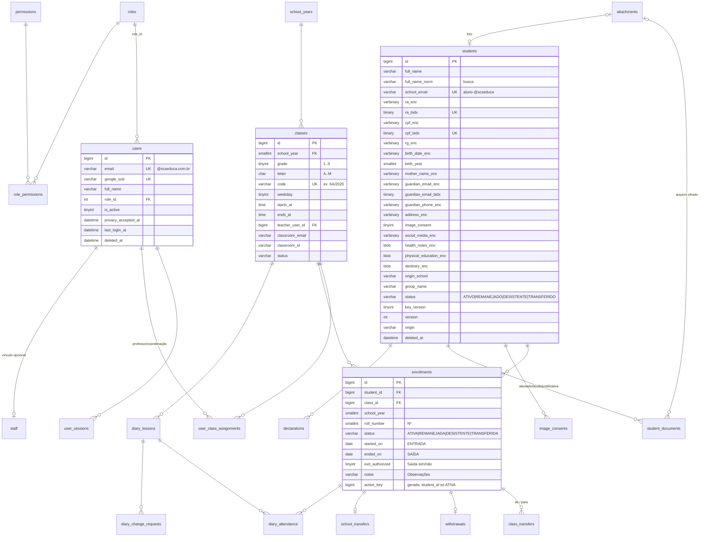
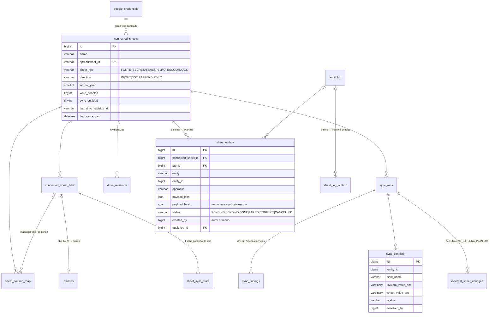
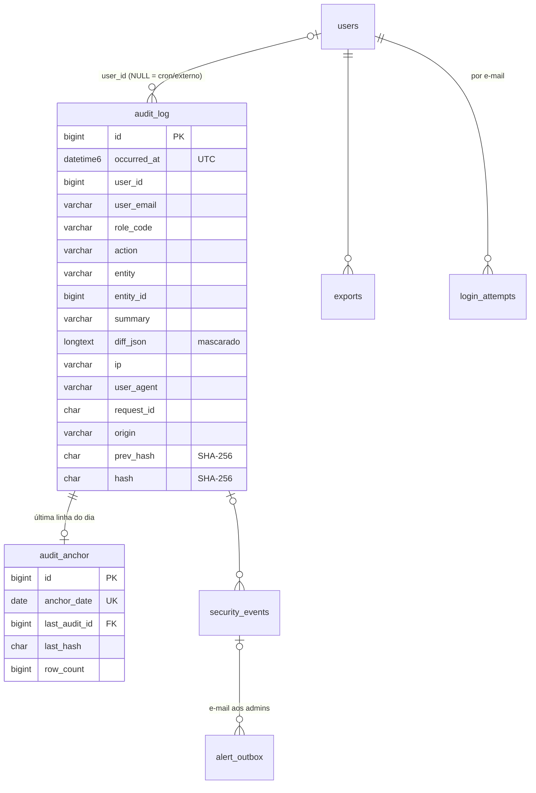

# Fase 1 — Modelagem do banco de dados
**Sistema de Gestão Escolar CELEF** · Centro de Estudos de Línguas do Ensino Fundamental · SME São Caetano do Sul

> Documento de aprovação. Nada de SQL foi gerado ainda: os arquivos `sql/schema.sql`, `sql/triggers.sql`,
> `sql/grants.sql` e `sql/seed.sql` serão escritos **depois do seu "ok"** a esta modelagem.

---

## 1. Plano de fases (confirmação)

| Fase | Entrega | Arquivos principais |
|---|---|---|
| **1** | Modelagem: ER, tabelas, triggers, privilégios, seed | `sql/*.sql`, `docs/fase-01-modelagem.md` |
| 2 | Núcleo de segurança | `app/config.php`, `Database.php`, `Security/*` (Crypto, Csrf, RateLimiter, AuditLog, Headers) |
| 3 | Login Google (OIDC + PKCE), RBAC, área `/admin` (usuários, administradores, perfis, configurações, sessões) | `Auth/*`, `controllers/Admin/*` |
| 4 | Cliente Google: `GoogleOAuthToken`, `GoogleJwt`, `SheetsClient`, `DriveClient`; telas Conta técnica / Planilhas conectadas / Planilha de logs; fila `sheet_log_outbox` | `Google/*`, `cron/flush_sheet_log.php` |
| 5 | Sincronização: mapeamento, entrada, saída, conflitos, alteração externa, carga inicial (dry-run) | `Google/SheetSync.php`, `cron/sync_sheets.php` |
| 6 | Turmas e Alunos (CRUD, soft delete, histórico, mascaramento) | `models/*`, `controllers/*`, `views/*` |
| 7 | Remanejamento, Desistência, Transferência | idem |
| 8 | Diário, Atestados, Justificativas, Laudos (uploads cifrados) | idem |
| 9 | Carômetro, Crachá, Declarações + identidade visual | idem, `public/assets/img/marca/` |
| 10 | Indicadores, painel de segurança, alertas por e-mail, backup cifrado | `cron/verify_audit.php`, `cron/backup.php` |
| 11 | Roteiro de testes de segurança e checklist final | `docs/testes-seguranca.md`, `LEIA-ME.md` |

Cada fase é entregue com arquivos completos, bloco "Como publicar" (cPanel/phpMyAdmin) e a pergunta
"Posso seguir para a fase N?".

---

## 2. Convenções adotadas em todas as tabelas

| Convenção | Regra |
|---|---|
| Engine / charset | `InnoDB`, `utf8mb4`, `utf8mb4_unicode_ci` |
| Chave primária | `id BIGINT UNSIGNED AUTO_INCREMENT` (catálogos pequenos: `INT UNSIGNED`) |
| Carimbo de criação/alteração | `created_at DATETIME(3)`, `created_by` (FK `users.id`, NULL quando origem = planilha/cron), `updated_at DATETIME(3) ON UPDATE`, `updated_by` |
| Controle de versão | `version INT UNSIGNED NOT NULL DEFAULT 1` — incrementado pelo trigger `BEFORE UPDATE`; usado como *lock otimista* e para casar com a planilha |
| Exclusão lógica | `deleted_at DATETIME(3) NULL`, `deleted_by`, `delete_reason VARCHAR(500)` (mín. 10 caracteres validado na app). **Não existe DELETE físico** em tabelas de negócio |
| Origem da alteração | `origin VARCHAR(60)`: `APP`, `CRON`, `PLANILHA:<nome>`, `CARGA_INICIAL_PLANILHA`, `FORA_DA_APLICACAO` |
| Campos cifrados | `<campo>_enc VARBINARY/BLOB` (XChaCha20-Poly1305, nonce embutido) + `key_version TINYINT UNSIGNED` por linha. Busca exata via **blind index** `<campo>_bidx BINARY(32)` (HMAC-SHA256 com chave separada, valor normalizado) |
| Enumerações | `VARCHAR` curto + `CHECK (... IN (...))` (MySQL ≥ 8.0.16 e MariaDB ≥ 10.2 aplicam o CHECK) + validação na app. Evita `ENUM` nativo, cujo `ALTER` em produção é caro e o usuário da app não pode executar |
| JSON | tipo `JSON` em colunas auxiliares; em `audit_log.diff_json` usa-se `LONGTEXT` (ver §5.2) |
| Fuso | `audit_log.occurred_at` em **UTC** com microssegundos (`DATETIME(6)`); demais datas em `America/Sao_Paulo` (horário escolar), convertidas pela app |
| Tabelas `*_history` | mesmas colunas da tabela-mãe + `history_id`, `history_op` (`UPDATE`/`SOFT_DELETE`/`RESTORE`), `history_at`, `history_by`, `history_origin`. Preenchidas **só por trigger**. Campos cifrados permanecem cifrados no histórico |

---

## 3. Diagrama ER

### 3.1 Núcleo pedagógico e de identidade

### 3.2 Integração Google e sincronização

### 3.3 Auditoria e segurança

---

## 4. Catálogo de tabelas

Legenda: 🔒 = contém campos cifrados · 📜 = tem `*_history` · 🚫 = append-only (triggers bloqueiam UPDATE e DELETE).
Colunas padrão (§2) omitidas para encurtar.

### 4.1 Identidade, acesso e sessão

| Tabela | Finalidade | Colunas específicas |
|---|---|---|
| `roles` | perfis fixos | `code` UK (`SUPER_ADMIN`, `ADMIN`, `SECRETARIA`, `COORDENACAO`, `PROFESSOR`, `AUDITOR`), `name`, `description`, `is_system` |
| `permissions` | permissões granulares | `code` UK (`aluno.ver`, `aluno.editar`, `aluno.ver_documentos`, `aluno.excluir`, `aluno.restaurar`, `turma.*`, `remanejamento.*`, `desistencia.*`, `diario.*`, `exportar`, `declaracao.emitir`, `admin.*`, `auditoria.ver`…), `module`, `description`, `is_sensitive` (exige reautenticação + motivo) |
| `role_permissions` | N:N | PK (`role_id`, `permission_id`) |
| `users` 📜 | pessoas físicas autorizadas | `email` UK (minúsculo, só `@scseduca.com.br`), `google_sub` UK (preenchido no 1º login), `full_name`, `picture_url`, `role_id` FK, `is_active`, `privacy_accepted_at`, `privacy_version`, `last_login_at`, `last_login_ip`, `amr_last` (claim `amr`), `notes` |
| `user_class_assignments` 📜 | escopo do professor/coordenação | `user_id`, `class_id`, `assignment_type` (`PROFESSOR`/`COORDENACAO`), `school_year`, `started_on`, `ended_on`; UK (`user_id`,`class_id`,`assignment_type`) |
| `user_sessions` | sessões server-side | `id CHAR(64)` = SHA-256 do id de sessão PHP, `user_id`, `created_at`, `last_seen_at`, `absolute_expires_at`, `google_auth_time` (para reautenticação `max_age`), `last_reauth_at`, `ip`, `user_agent_hash`, `user_agent`, `revoked_at`, `revoked_by`, `revoke_reason` (`LOGOUT`, `INATIVIDADE`, `ABSOLUTA`, `ADMIN`, `TROCA_UA_IP`) |
| `oauth_states` | PKCE/state/nonce do login e da conta técnica | `state_hash` PK, `nonce_hash`, `code_verifier_enc`, `purpose` (`LOGIN`, `REAUTH`, `TECH_ACCOUNT`), `redirect_to`, `user_id` NULL, `ip`, `expires_at`, `used_at` |
| `login_attempts` 🚫 | base do rate limit e dos alertas | `email`, `google_sub`, `ip`, `user_agent`, `outcome` (`OK`, `DOMINIO_INVALIDO`, `NAO_CADASTRADO`, `INATIVO`, `CONTA_GENERICA`, `TOKEN_INVALIDO`, `BLOQUEADO_RATE`), `detail`, `occurred_at` |
| `blocked_email_patterns` 📜 | contas genéricas proibidas | `pattern` (LIKE, ex. `celef@%`, `celef%2026@%`), `description`, `is_active` |
| `rate_limits` | contador por janela | `bucket_key VARCHAR(190)` PK (`login:ip:…`, `user:…:ver_sensivel`), `window_start`, `hit_count`, `blocked_until` |
| `settings` 📜 | configurações editáveis no admin | `setting_key` PK, `value_json`, `value_type`, `group_name`, `description`, `is_sensitive` (ex.: `session.idle_minutes=15`, `session.absolute_hours=8`, `sync.batch_rows=500`, `sync.max_seconds=60`, `sync.cron_minutes=5`, `alerts.emails`, `lgpd.retention_years`, `diary.edit_days=7`, `sensitive.hourly_limit=50`) |
| `privacy_acknowledgements` 🚫 | ciência do aviso de privacidade | `user_id`, `version`, `accepted_at`, `ip`, `user_agent` |

> `SUPER_ADMIN_EMAILS` do `.env` **não vai para o banco**: a proteção contra rebaixamento/desativação é
> aplicada pela app comparando o e-mail com a lista do `.env`. Assim, quem só tem acesso ao phpMyAdmin
> não consegue "desproteger" o Super Admin.

### 4.2 Auditoria e segurança

| Tabela | Finalidade | Colunas específicas |
|---|---|---|
| `audit_log` 🚫 | trilha imutável com cadeia de hash | `occurred_at DATETIME(6)` UTC, `user_id`, `user_email`, `role_code`, `action` (ver lista no §5.2), `entity`, `entity_id`, `summary VARCHAR(300)`, `diff_json LONGTEXT` (mascarado), `ip`, `user_agent VARCHAR(300)`, `request_id CHAR(32)`, `session_hash CHAR(64)`, `origin`, `prev_hash CHAR(64)`, `hash CHAR(64)`. Índices: (`occurred_at`), (`user_id`,`occurred_at`), (`entity`,`entity_id`), (`action`,`occurred_at`) |
| `audit_anchor` 🚫 | âncora diária | `anchor_date` UK, `last_audit_id` FK, `last_hash`, `row_count`, `created_at` |
| `audit_verification_runs` 🚫 | resultado do `cron/verify_audit.php` | `started_at`, `finished_at`, `from_id`, `to_id`, `rows_checked`, `result` (`OK`/`QUEBRA`), `first_broken_id`, `detail` |
| `security_events` | alertas e detecções | `occurred_at`, `severity` (`INFO`/`AVISO`/`CRITICO`), `kind` (`LOGIN_NEGADO_REPETIDO`, `LEITURA_MASSIVA`, `ALTERACAO_EXTERNA_PLANILHA`, `FORA_DA_APLICACAO`, `QUEBRA_HASH`, `FALHA_SYNC`, `FALHA_LOG_PLANILHA`, `TOKEN_GOOGLE_INVALIDO`, `EXPORTACAO`, `ACAO_ADMIN`…), `user_id`, `entity`, `entity_id`, `detail_json`, `audit_log_id`, `alert_sent_at`, `acknowledged_at`, `acknowledged_by` |
| `alert_outbox` | fila de e-mails aos administradores | `kind`, `recipients_json`, `subject`, `body_text`, `body_html`, `security_event_id`, `status` (`PENDING`/`SENT`/`FAILED`), `attempts`, `next_attempt_at`, `last_error`, `sent_at` |
| `exports` 🚫 | registro de exportações | `user_id`, `kind` (`CSV`/`PDF`/`XLSX`), `entity`, `filters_json`, `record_count`, `reason`, `watermark_id CHAR(16)`, `file_sha256`, `requires_approval`, `approved_by`, `approved_at`, `audit_log_id` |
| `cron_runs` | execução de cada job (detecta "parado há > 30 min") | `job_name`, `started_at`, `finished_at`, `status`, `summary`, `error` |
| `backups` | backups cifrados e teste de restauração | `kind` (`DIARIO`/`MANUAL`), `file_name`, `size_bytes`, `sha256`, `drive_file_id`, `status`, `error`, `restore_tested_at`, `restore_tested_by`, `restore_result` |

### 4.3 Integração Google

| Tabela | Finalidade | Colunas específicas |
|---|---|---|
| `google_credentials` 🔒📜 | conta técnica (celef@) ou Service Account | `kind` (`OAUTH_USER_ACCOUNT`/`SERVICE_ACCOUNT`), `account_email`, `secret_enc` (refresh token **ou** JSON da SA), `key_version`, `scopes`, `status` (`CONNECTED`/`REVOKED`/`ERROR`), `is_active` (só uma ativa), `connected_at`, `connected_by`, `last_refresh_at`, `last_test_at`, `last_error`, `revoked_at`, `revoked_by` |
| `connected_sheets` 📜 | planilhas cadastradas no admin | `name`, `spreadsheet_id` UK, `sheet_role` (`FONTE_SECRETARIA`/`ESPELHO_ESCOLA`/`LOGS`), `direction` (`IN`/`OUT`/`BOTH`/`APPEND_ONLY`), `school_year`, `write_enabled` (padrão **0** para FONTE_SECRETARIA), `sync_enabled`, `owner_email`, `last_test_at`, `last_test_result`, `last_drive_revision_id`, `last_drive_modified_at`, `last_synced_at` |
| `connected_sheet_tabs` 📜 | abas e seu papel | `connected_sheet_id`, `tab_title`, `sheet_gid`, `tab_kind` (`TURMA`, `ALUNOS`, `REMANEJAMENTOS`, `DESISTENTES`, `TOTAIS`, `EXCLUIDOS`, `LOG_*`), `class_id` NULL (aba 1A…9I ↔ turma), `header_row` (1), `first_data_row` (2), `key_field` (`ra`/`school_email`), `control_cols_start` (coluna das colunas ocultas `ÚLTIMA ALTERAÇÃO`, `ALTERADO POR`, `ID SISTEMA`), `protected_range_id`, `is_active`; UK (`connected_sheet_id`,`sheet_gid`) |
| `sheet_column_map` 📜 | cabeçalho ↔ campo do sistema | `connected_sheet_id`, `tab_id` NULL (NULL = vale para todas as abas do mesmo `tab_kind`), `tab_kind`, `column_header`, `column_index`, `field_name`, `transform` (`DATE_BR`, `SIM_NAO`, `UPPER`, `DIGITS`…), `is_key`, `direction` (`IN`/`OUT`/`BOTH`), `write_allowed` (LGPD: pode ser escrito na planilha?), `is_control` |
| `sheet_sync_state` | último estado conhecido de cada linha | `tab_id`, `row_number`, `row_key`, `entity`, `entity_id`, `row_hash CHAR(64)`, `system_version` (versão do registro na última sync), `status` (`OK`/`MISSING`/`CONFLICT`/`PENDING_CONFIRMATION`/`EXCLUDED`), `first_seen_at`, `last_seen_at`, `missing_since`, `last_synced_at`; UK (`tab_id`,`row_key`) |
| `sync_runs` | cada execução | `trigger_type` (`CRON`/`MANUAL`/`OPORTUNISTA`), `triggered_by`, `connected_sheet_id`, `mode` (`DRY_RUN`/`WRITE`), `direction`, `started_at`, `finished_at`, `status` (`RUNNING`/`OK`/`PARTIAL`/`ERROR`), `rows_read`, `rows_created`, `rows_updated`, `rows_written`, `conflicts`, `external_changes`, `errors`, `cursor_json` (retoma de onde parou), `log_excerpt` |
| `sync_findings` | inconsistências do dry-run e da carga | `sync_run_id`, `tab_id`, `row_number`, `row_key`, `severity`, `code` (`CPF_INVALIDO`, `DUPLICADO_CPF`, `ALUNO_EM_DUAS_TURMAS`, `TURMA_INEXISTENTE`, `SEM_CHAVE`, `LINHA_VAZIA`, `DATA_INVALIDA`, `EMAIL_INVALIDO`), `message`, `detail_json` (mascarado), `resolved_at`, `resolved_by` |
| `sync_conflicts` 🔒 | mesmo campo mudou nos dois lados | `sync_run_id`, `connected_sheet_id`, `tab_id`, `row_number`, `row_key`, `entity`, `entity_id`, `field_name`, `base_value_enc`, `system_value_enc`, `sheet_value_enc`, `key_version`, `detected_at`, `status` (`PENDING`/`KEEP_SYSTEM`/`KEEP_SHEET`/`MANUAL`/`IGNORED`), `resolved_at`, `resolved_by`, `resolution_note` |
| `external_sheet_changes` 🚫 | edição feita fora do sistema | `sync_run_id`, `connected_sheet_id`, `tab_id`, `row_number`, `column_header`, `row_key`, `old_value_masked`, `new_value_masked`, `drive_revision_id`, `drive_modified_at`, `drive_user_email`, `authorship_identified` (0 quando o autor é a própria celef@), `detected_at`, `security_event_id`, `audit_log_id` |
| `drive_revisions` 🚫 | histórico lido via `revisions.list` | `connected_sheet_id`, `revision_id`, `modified_at`, `modifying_user_email`, `modifying_user_name`, `fetched_at`; UK (`connected_sheet_id`,`revision_id`) |
| `sheet_outbox` | fila Sistema → Planilha | `connected_sheet_id`, `tab_id`, `entity`, `entity_id`, `operation` (`UPDATE_ROW`, `APPEND_ROW`, `MARK_EXCLUDED`, `APPEND_REMANEJAMENTO`, `APPEND_DESISTENTE`, `UPDATE_TOTALS`), `row_key`, `row_number` NULL, `payload_json` (valores já sanitizados contra injeção de fórmula), `payload_hash CHAR(64)`, `expected_row_hash` (estado que a planilha deve ter; se diferente → conflito), `status` (`PENDING`/`SENDING`/`DONE`/`FAILED`/`CONFLICT`/`CANCELLED`), `attempts`, `next_attempt_at`, `last_error`, `created_by` (**autor humano**), `audit_log_id`, `sent_at` |
| `sheet_log_outbox` | fila Banco → Planilha de logs | `tab_name` (`AUDITORIA`, `ACESSOS`, `SEGURANCA`, `ADMIN`, `SINCRONIZACAO`, `EXPORTACOES`, `ANCORAS`), `audit_log_id` NULL, `row_values_json` (sem dado sensível), `row_hash`, `status`, `attempts`, `next_attempt_at`, `last_error`, `sent_at`, `sheet_row_number` |

### 4.4 Negócio (escola)

| Tabela | Finalidade | Colunas específicas |
|---|---|---|
| `school_years` 📜 | ano letivo | `year` PK (2026, 2027…), `is_current`, `starts_on`, `ends_on`, `label` |
| `classes` 📜 | turmas | `school_year` FK, `grade` (1–9), `letter` (A–M), `code` UK (gerado `CONCAT(grade,letter,'/',school_year)`), `weekday` (1–7), `starts_at`, `ends_at`, `teacher_user_id` FK, `classroom_email`, `classroom_id`, `room`, `status` (`ATIVA`/`ENCERRADA`), `capacity` |
| `students` 🔒📜 | ficha do aluno (uma linha por pessoa) | ver diagrama §3.1. Detalhes: `full_name_norm` (sem acento, maiúsculo, para busca), `school_email` UK (e-mail do aluno @scseduca), `ra_bidx` UK, `cpf_bidx` UK, `birth_year SMALLINT` (plano, só para indicadores), `image_consent` (denormalizado de `image_consents`), `photo_attachment_id` FK, `origin_school` (ESCOLA), `group_name` (GRUPO), `status`, `social_media_enc` (⚠️ campo a revisar com a direção), `health_notes_enc`, `physical_education_enc`, `dentistry_enc`, `source_row_key` (chave original da planilha) |
| `image_consents` 🚫 | autorização de imagem versionada | `student_id`, `consented` (0/1), `term_version`, `recorded_at`, `recorded_by`, `source` (`APP`/`PLANILHA`), `notes` |
| `enrollments` 📜 | matrícula do aluno na turma, por ano | ver diagrama. `active_key BIGINT GENERATED ALWAYS AS (IF(status='ATIVA', student_id, NULL)) STORED` + UK (`active_key`,`school_year`) → **impossível** aluno ativo em duas turmas no mesmo ano; UK (`class_id`,`roll_number`) parcial via `roll_key` gerada da mesma forma |
| `class_transfers` 📜 | remanejamentos | `student_id`, `from_enrollment_id`, `to_enrollment_id`, `from_class_id`, `to_class_id`, `school_year`, `transferred_at` **(servidor)**, `transferred_by` **(usuário logado)**, `record_moved_at`, `record_moved_by` (prontuário), `reason`, `sheet_outbox_id` |
| `withdrawals` 📜 | desistências | `student_id`, `enrollment_id`, `class_id`, `withdrawn_at`, `withdrawn_by`, `reason_code` (`MUDANCA`, `HORARIO`, `SAUDE`, `FAMILIA`, `OUTRO`), `reason`, `documents_returned_at`, `documents_returned_by`, `sheet_outbox_id` |
| `school_transfers` 📜 | transferências para outra escola | `student_id`, `enrollment_id`, `transferred_at`, `transferred_by`, `destination_school`, `declaration_id`, `notes` |
| `diary_lessons` 📜 | aula do diário | `class_id`, `lesson_date`, `lesson_number`, `content TEXT`, `homework`, `locked_at` (após `diary.edit_days`), `unlock_request_id`; UK (`class_id`,`lesson_date`,`lesson_number`) |
| `diary_attendance` 📜 | frequência por aluno/aula | `lesson_id`, `enrollment_id`, `status` (`P`/`F`/`FJ`), `note`; UK (`lesson_id`,`enrollment_id`) |
| `diary_change_requests` | edição fora do prazo | `lesson_id`, `requested_by`, `justification`, `status` (`PENDING`/`APPROVED`/`REJECTED`), `decided_by`, `decided_at`, `decision_note` |
| `student_documents` 🔒📜 | atestados, laudos, justificativas de falta | `student_id`, `enrollment_id` NULL, `kind` (`ATESTADO`/`LAUDO`/`JUSTIFICATIVA`/`OUTRO`), `from_date`, `to_date`, `days`, `details_enc`, `key_version`, `attachment_id`, `access_level` (`RESTRITO`/`COORDENACAO`/`TURMA`), `recorded_by` |
| `attachments` 🔒📜 | arquivos cifrados em `storage/` | `owner_entity`, `owner_id`, `kind` (`FOTO`/`ATESTADO`/`LAUDO`/`JUSTIFICATIVA`/`MARCA`), `original_name_enc`, `stored_name` (aleatório), `mime_type` (validado pelo conteúdo), `size_bytes`, `sha256`, `key_version`, `uploaded_by` |
| `staff` 🔒📜 | servidores/funcionários | `user_id` FK NULL, `full_name`, `job_title`, `registration_enc` (matrícula funcional), `phone_enc`, `work_email`, `status`, `started_on`, `ended_on` |
| `declaration_templates` 📜 | modelos de declaração | `code` UK, `name`, `body_html`, `version`, `is_active` |
| `declarations` 🚫 | declarações emitidas | `student_id`, `template_id`, `template_version`, `control_number` UK (`2026-000123`), `verification_token_hash CHAR(64)` (QR), `payload_json` (snapshot dos dados impressos), `pdf_sha256`, `issued_at`, `issued_by`, `revoked_at`, `revoked_by`, `revoke_reason` |
| `branding_assets` 📜 | identidade visual trocável no admin | `kind` (`LOGO`/`LOGO_BRANCO`/`FACHADA`/`FAVICON`), `attachment_id`, `is_active`, `palette_json` (cores extraídas do logo) |

Tabelas `*_history` geradas (22): `users`, `user_class_assignments`, `blocked_email_patterns`, `settings`,
`google_credentials`, `connected_sheets`, `connected_sheet_tabs`, `sheet_column_map`, `school_years`, `classes`,
`students`, `enrollments`, `class_transfers`, `withdrawals`, `school_transfers`, `diary_lessons`,
`diary_attendance`, `student_documents`, `attachments`, `staff`, `declaration_templates`, `branding_assets`.

---

## 5. Decisões de segurança (as não óbvias)

### 5.1 Dois usuários MySQL e o que o cPanel realmente permite
- `celef_app`: **SELECT, INSERT, UPDATE, EXECUTE** apenas. É o único usuário no `.env`.
- `celef_install`: ALL PRIVILEGES, usado só no phpMyAdmin para importar `schema.sql`/`triggers.sql`.
- Na HostGator **não é possível rodar `GRANT` no phpMyAdmin** (a conta não tem privilégio GRANT): o
  `grants.sql` será um arquivo de referência + roteiro ilustrado "cPanel → MySQL Databases → Add User To
  Database → marcar só SELECT/INSERT/UPDATE/EXECUTE". Também não há grants por tabela via cPanel, por isso
  a imutabilidade de `audit_log` **não depende de privilégio**: depende de trigger (§5.3).

### 5.2 Cadeia de hash calculada **no banco**, não só na app
- `BEFORE INSERT` em `audit_log` lê o `hash` da última linha, grava `prev_hash` e calcula
  `hash = SHA2(CONCAT_WS('|', prev_hash, occurred_at formatado, COALESCE(user_id,''), user_email, role_code,
  action, entity, COALESCE(entity_id,''), summary, COALESCE(diff_json,''), ip, request_id, origin), 256)`.
- Vantagem: até uma linha inserida pelo phpMyAdmin entra na cadeia; não existe caminho para inserir uma
  linha "fora da corrente". O `cron/verify_audit.php` recalcula em PHP com a mesma fórmula.
- `diff_json` é `LONGTEXT`, não `JSON`: o tipo JSON do MySQL reordena chaves ao armazenar, o que faria o
  hash calculado em PHP divergir do texto gravado. A app grava JSON canônico (chaves ordenadas).
- Concorrência: a app envolve o INSERT em `GET_LOCK('celef_audit', 5)` para evitar duas linhas com o mesmo
  `prev_hash` (bifurcação, que o verificador trataria como quebra).
- `occurred_at` em UTC com 6 casas: ordem total e independência de horário de verão.

### 5.3 Triggers como segunda muralha (sem DEFINER)
- `BEFORE UPDATE` e `BEFORE DELETE` em `audit_log`, `audit_anchor`, `login_attempts`, `exports`,
  `declarations`, `image_consents`, `privacy_acknowledgements`, `external_sheet_changes`, `drive_revisions`,
  `audit_verification_runs`: `SIGNAL SQLSTATE '45000'` com mensagem em pt-BR.
- `BEFORE DELETE` em **todas** as tabelas de negócio: também `SIGNAL`. Bloqueia inclusive o usuário de
  instalação e um clique errado no phpMyAdmin. A única forma de apagar é remover o trigger antes (ação que
  fica no histórico de versões do próprio banco e é detectada pelo verificador, que confere a existência
  dos triggers a cada execução).
- `BEFORE UPDATE` nas tabelas 📜: copia `OLD.*` para `*_history`, incrementa `version`, define
  `history_origin = COALESCE(@app_origin, 'FORA_DA_APLICACAO')` e `history_by = @app_user_id`. Quando
  `@app_user_id` é NULL **e** `@app_origin` não é `CRON`/`PLANILHA:*`, o trigger também insere em
  `security_events` (`FORA_DA_APLICACAO`) — o alerta por e-mail é enviado pela app/cron ao ler essa tabela
  (trigger não envia e-mail).
- `BEFORE UPDATE` em `enrollments`, `students`, `classes`…: se `OLD.deleted_at IS NULL AND NEW.deleted_at IS NOT NULL`,
  exige `NEW.delete_reason` com ≥ 10 caracteres e `NEW.deleted_by` não nulo (ou `@app_origin` de sync), senão `SIGNAL`.
- SQL gerado **sem `DEFINER`**, como exigido na hospedagem compartilhada.

### 5.4 Criptografia de campo e blind index
- XChaCha20-Poly1305 (libsodium) com nonce aleatório de 24 bytes prefixado ao ciphertext; `key_version`
  por linha permite rotação gradual (`cron` re-cifra em lotes).
- Blind index = HMAC-SHA256(chave separada, valor normalizado) truncado a 32 bytes. CPF/R.A. normalizados
  só com dígitos; e-mail em minúsculo. Permite `WHERE cpf_bidx = ?` sem revelar nada e sem busca parcial.
- `birth_year` fica em claro só para indicadores por faixa etária; a data completa é cifrada.
- Em `sync_conflicts`, os dois valores em disputa também são cifrados (podem ser CPF, telefone etc.).

### 5.5 Autoria humana mesmo quando a conta técnica escreve
- `sheet_outbox.created_by` e `audit_log.user_id` são sempre o usuário @scseduca logado; a conta celef@ é
  só o transporte. As colunas de controle da planilha (`ALTERADO POR`) recebem o e-mail desse usuário.
- `payload_hash` em `sheet_outbox` permite reconhecer, na leitura seguinte, que a diferença encontrada foi
  escrita pelo próprio sistema. Diferença sem outbox correspondente ⇒ `external_sheet_changes` + alerta.

### 5.6 Regras de integridade no próprio esquema
- Coluna gerada `active_key` em `enrollments` + índice único: aluno ativo não pode estar em duas turmas no
  mesmo ano, mesmo que a sincronização tente.
- `connected_sheets.write_enabled` nasce `0` para `FONTE_SECRETARIA`; mudar exige Super Admin + reautenticação.
- `google_credentials`: índice único em `is_active` com coluna gerada (`IF(is_active=1,1,NULL)`) garante uma
  única credencial ativa.

---

## 6. Premissas assumidas (confirme ou corrija junto com o "ok")

1. **"SAÍDA" sim/não** (planilha TURMAS-2027 e coluna repetida na ALUNOS 2026) foi interpretada como
   *"autorizado a sair sozinho"* → `enrollments.exit_authorized`. A outra "SAÍDA" (data) é `enrollments.ended_on`.
2. **Data de nascimento** será **cifrada** (`birth_date_enc`), guardando só `birth_year` em claro para indicadores.
3. **Atestados, laudos e justificativas** ficam numa única tabela `student_documents` (coluna `kind`) em vez
   de três tabelas quase idênticas; a interface continua separada por módulo.
4. **Prazo de edição do diário** pelo professor: 7 dias (configurável em `settings`).
5. **2026 e 2027 coexistem**: `school_years` + `school_year` em `classes`/`enrollments`; cada planilha conectada
   indica o ano a que pertence.
6. **Observações** da lista de turma (`enrollments.notes`) ficam em claro, por serem pedagógicas e irem para a
   planilha; qualquer observação de saúde deve ir para `student_documents`/`health_notes_enc` (cifrados).
7. O SQL será compatível com **MySQL 8.0.16+ e MariaDB 10.6+** (CHECK aplicado, colunas geradas, `DATETIME(6)`).

---

## 7. Próximo passo

Com o seu **"ok"** (e eventuais ajustes às premissas do §6) gero, completos:

- `sql/schema.sql` — todas as tabelas acima e as `*_history`, idempotente (`IF NOT EXISTS`);
- `sql/triggers.sql` — hash da auditoria, bloqueios de UPDATE/DELETE, versionamento, detecção `FORA_DA_APLICACAO`;
- `sql/grants.sql` — usuários `celef_app`/`celef_install` para referência + roteiro cPanel;
- `sql/seed.sql` — perfis, permissões, padrões de e-mail bloqueados, configurações iniciais, aviso de
  privacidade v1 e o Super Administrador `flaviospina@scseduca.com.br`.
